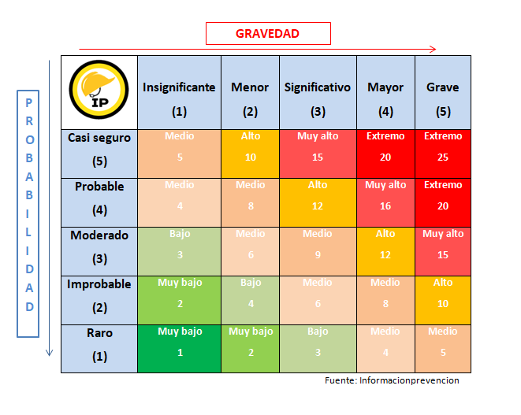
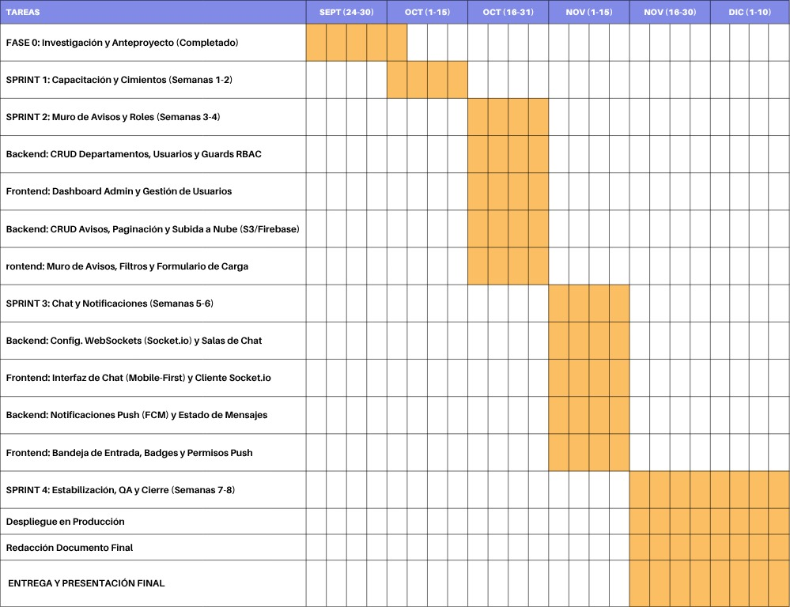
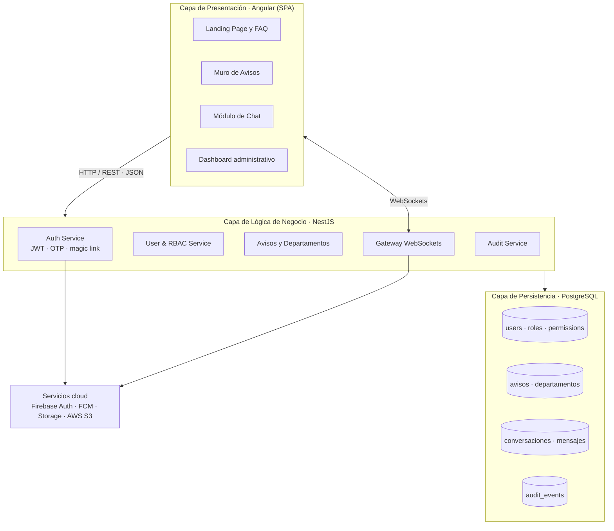
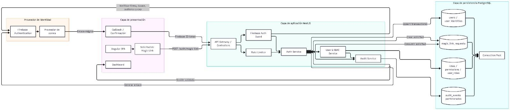
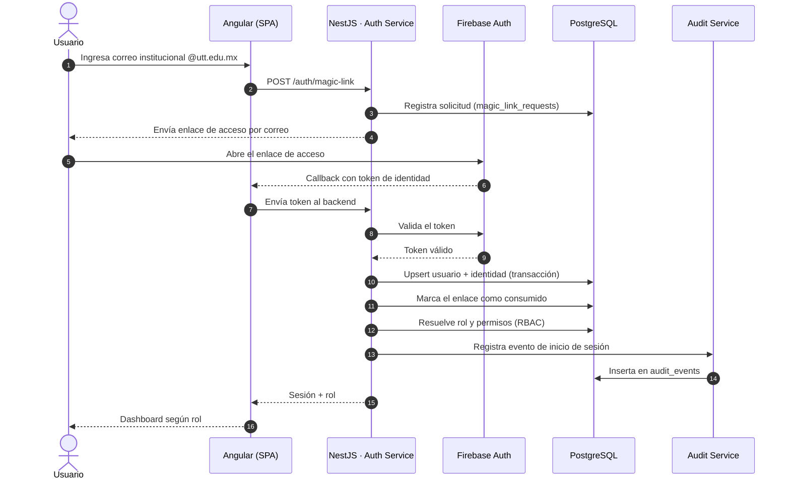
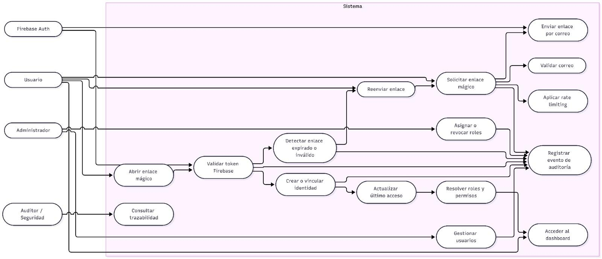
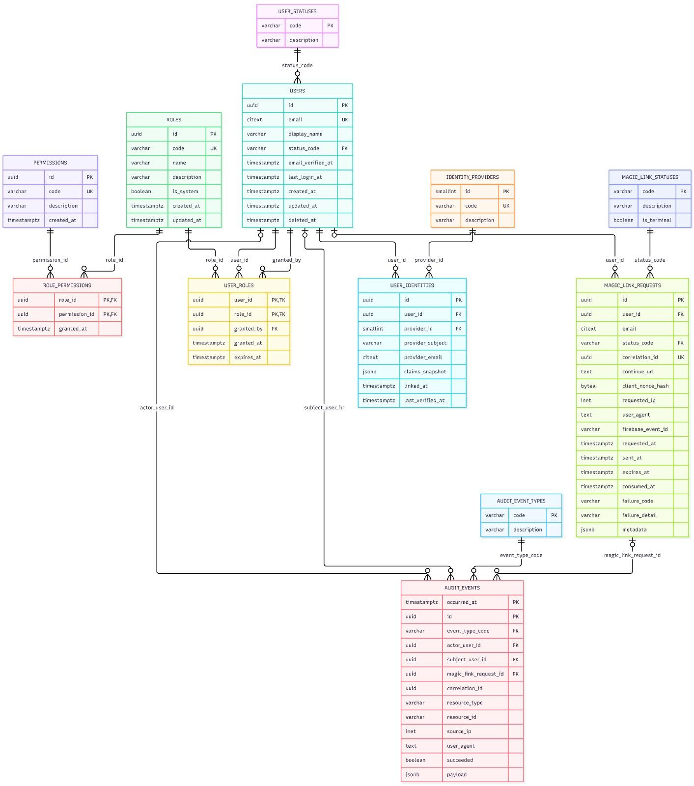
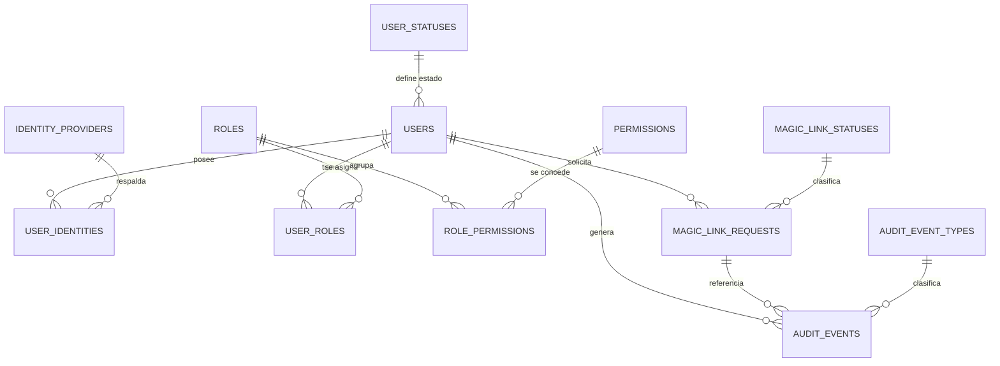
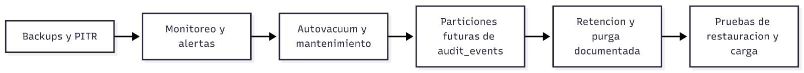

<div align="center">

# 🔗 UTT Connect

### Plataforma web unificada de comunicación y consulta institucional

**Universidad Tecnológica de Torreón (UTT)** · Equipo 1


</div>

---

> **Documento central de la documentación del proyecto.**
> Este repositorio concentra la problemática, objetivos, alcances, requisitos funcionales y no funcionales, análisis de riesgos, metodología, arquitectura, wireframes, estrategia de versionamiento y diagramas del sistema **UTT Connect**.

**Documento fuente:** [Google Docs — Documentación UTT Connect](https://docs.google.com/document/d/1ks0DMZF9ycsIt-XXPKo2HsNbVHlu1prhy2TGi9cf4AE/edit)
**Repositorio:** `git@github.com:UTTCONNECT/DOCUMENTATION.git` · Rama `master`

---

<a id="tabla-de-contenido"></a>

## 📑 Tabla de contenido

1. [Descripción general](#descripcion-general)
2. [Problemática](#problematica)
3. [Objetivos](#objetivos)
4. [Justificación](#justificacion)
5. [Alcances y limitaciones](#alcances-y-limitaciones)
6. [Producto Mínimo Viable (MVP)](#mvp)
7. [Requisitos funcionales (RF)](#requisitos-funcionales-rf)
8. [Requisitos no funcionales (RNF)](#requisitos-no-funcionales-rnf)
9. [Análisis de riesgos](#analisis-de-riesgos)
10. [Metodología de desarrollo](#metodologia-de-desarrollo)
11. [Equipo y roles](#equipo-y-roles)
12. [Plan de trabajo por sprint](#plan-de-trabajo-por-sprint)
13. [Cronograma](#cronograma)
14. [Arquitectura del sistema](#arquitectura-del-sistema)
15. [Tecnologías](#tecnologias)
16. [Descripción de contenidos (wireframe)](#descripcion-de-contenidos)
17. [Estrategia de versionamiento](#estrategia-de-versionamiento)
18. [Repositorios y evidencias](#repositorios-y-evidencias)
19. [Diccionario de datos](#diccionario-de-datos)
20. [Estructura del repositorio](#estructura-del-repositorio)
21. [Cómo contribuir](#como-contribuir)
22. [Licencia y créditos](#licencia-y-creditos)
23. [Anexo A. Notas de consolidación documental](#anexo-a)

---

<a id="descripcion-general"></a>

## 1. Descripción general

**UTT Connect** es una plataforma web de comunicación y consulta institucional para la Universidad Tecnológica de Torreón. Su propósito es centralizar y categorizar la difusión de avisos oficiales en tiempo real, agilizar la gestión de trámites y solicitudes mediante un tablero informativo estructurado y habilitar un sistema de mensajería directa interdepartamental.

La plataforma opera como un **canal oficial único** entre las áreas administrativas, el personal docente y la comunidad estudiantil, reduciendo los tiempos de respuesta y la ambigüedad en los procesos institucionales.

### Ficha técnica del proyecto

| Campo | Valor |
|---|---|
| **Nombre del producto** | UTT Connect |
| **Institución** | Universidad Tecnológica de Torreón (UTT) |
| **Tipo de solución** | Aplicación web (SPA) de comunicación institucional |
| **Usuarios objetivo** | Alumnos, docentes, directivos y personal administrativo |
| **Dominio de acceso** | Cuentas de correo `@utt.edu.mx` |
| **Roles del sistema** | Lector · Departamento · Administrador |
| **Metodología** | Scrumban (Scrum + Kanban) |
| **Arquitectura** | Tres capas + Single Page Application |
| **Stack principal** | Angular · NestJS · PostgreSQL |
| **Equipo** | Equipo 1 — 5 integrantes |
| **Periodo de ejecución** | Octubre – Diciembre |

### Pilares funcionales

| Pilar | Descripción |
|---|---|
| **Autenticación institucional** | Acceso exclusivo con correo `@utt.edu.mx`, verificación por OTP y control de sesiones concurrentes. |
| **Muro de avisos** | Publicación departamental de avisos con adjuntos, búsqueda por palabras clave y filtros por fecha y departamento. |
| **Soporte directo** | Mensajería individual en tiempo real (WebSockets) entre estudiantes y dependencias administrativas. |
| **Administración** | Gestión de departamentos, cuentas y auditoría de accesos bajo el rol Administrador. |
| **Notificaciones** | Avisos push globales ante la publicación de contenido nuevo. |

---

<a id="problematica"></a>

## 2. Problemática

En la Universidad Tecnológica de Torreón se ha detectado una **ineficiencia en los canales de comunicación institucionales** que vinculan a la dirección, los departamentos administrativos, el cuerpo docente y la comunidad estudiantil.

Esta deficiencia en la coordinación interdepartamental e institucional genera ambigüedad recurrente respecto a los lineamientos, requisitos y procedimientos operativos para la realización de trámites académicos y administrativos, tales como:

- Inscripciones
- Servicio social
- Estadías profesionales
- Pagos
- Titulación
- Gestión de becas

Como resultado, la comunidad estudiantil enfrenta un **flujo de información incompleto o contradictorio**, lo que deriva en desplazamientos presenciales innecesarios a las instalaciones de la universidad.

### Impacto identificado

| Dimensión | Consecuencia |
|---|---|
| **Socioeconómica** | Uso ineficiente del tiempo y costos imprevistos en transporte y reprografía. |
| **Operativa** | Rechazo recurrente de solicitudes por incumplimiento de formatos o plazos no clarificados oportunamente. |
| **Institucional** | Carencia de un sistema de comunicación centralizado y oficial que compromete la resolución eficaz de dudas. |
| **Académica** | Afectación directa al trayecto académico del alumnado. |

---

<a id="objetivos"></a>

## 3. Objetivos

<a id="objetivo-general"></a>

### 3.1 Objetivo general

> Diseñar, desarrollar e implementar una plataforma web unificada de comunicación y consulta institucional para la Universidad Tecnológica de Torreón (UTT), orientada a centralizar y categorizar la difusión de avisos oficiales en tiempo real, así como a agilizar la gestión de trámites y solicitudes mediante un tablero informativo estructurado y un sistema de mensajería directa interdepartamental, con el propósito de optimizar la interacción entre las áreas administrativas, el personal docente y la comunidad estudiantil, reduciendo los tiempos de respuesta y la ambigüedad en los procesos institucionales.

<a id="objetivos-especificos"></a>

### 3.2 Objetivos específicos

| # | Objetivo | Enfoque |
|---|---|---|
| **1** | **Arquitectura y publicación.** Diseñar el módulo de muro informativo categorizado, restringiendo los permisos de creación y gestión de contenido exclusivamente a usuarios con rol administrativo validado. | Producto |
| **2** | **Seguridad y control de usuarios.** Implementar el mecanismo de autenticación del sistema vinculado al dominio de correo institucional (`@utt.edu.mx`) para garantizar un entorno seguro y exclusivo para la comunidad universitaria. | Seguridad |
| **3** | **Módulo de comunicación.** Desarrollar el canal de atención personalizada mediante un sistema de chat individual departamental que permita el seguimiento directo de trámites y consultas. | Producto |
| **4** | **Validación e impacto.** Validar la usabilidad de la plataforma y su efectividad en la optimización de los tiempos de atención, la reducción de trámites extemporáneos y la disminución de desplazamientos innecesarios del alumnado. | Calidad |

---

<a id="justificacion"></a>

## 4. Justificación

La ausencia de un canal de comunicación directo y estandarizado en la UTT genera un impacto negativo directo en la comunidad estudiantil, manifestado en la duplicidad de trámites, la dilación en procesos académico-administrativos y desembolsos económicos imprevistos de movilidad y reprografía.

En este contexto, la implementación de la plataforma web se justifica por la necesidad apremiante de **transparentar los flujos informativos** y **coordinar con eficiencia** la interacción entre las dependencias administrativas y el alumnado.

Al consolidar un entorno digital centralizado y verificado, se garantiza la accesibilidad e integridad de la información oficial. Ello permite:

- Mitigar el margen de error en la integración y entrega de expedientes.
- Reducir los costos operativos y de traslado para los estudiantes.
- Optimizar la capacidad operativa del personal universitario al sistematizar la atención de consultas recurrentes.

---

<a id="alcances-y-limitaciones"></a>

## 5. Alcances y limitaciones

<a id="alcance-del-proyecto"></a>

### 5.1 Alcance del proyecto

El desarrollo de la plataforma web abarca las siguientes dimensiones operativas, funcionales y tecnológicas.

#### Alcance institucional y de usuarios

- Plataforma delimitada de manera exclusiva a la comunidad universitaria de la UTT: alumnos, docentes, directivos y personal administrativo.
- Mecanismo de autenticación restringido estrictamente al uso de cuentas con el dominio de correo institucional `@utt.edu.mx`.

#### Alcance funcional (requisitos funcionales)

| Componente | Alcance |
|---|---|
| **Gestión de roles y accesos** | Tres niveles de permisos: **Lector** (consulta), **Departamento** (gestión de contenido) y **Administrador** (gestión global de usuarios, departamentos y auditoría). |
| **Muro de avisos centralizado** | Módulo de publicación departamental con soporte para archivos adjuntos, búsqueda por palabras clave y filtros multidimensionales (por fecha y departamento). |
| **Módulo de soporte directo** | Canal de atención bidireccional mediante mensajería individual entre estudiantes y dependencias administrativas, estructurado en pestañas de mensajes. |
| **Auditoría y monitoreo de seguridad** | Registro automatizado de inicio de sesión con captura de dirección IP, fecha, hora y rol, complementado con un control estricto de concurrencia (máximo 2 sesiones activas simultáneas). |

#### Alcance técnico y de seguridad (requisitos no funcionales)

| Componente | Alcance |
|---|---|
| **Comunicación en tiempo real** | Transmisión instantánea de mensajes en el chat mediante arquitectura de WebSockets. |
| **Sistema de notificaciones** | Emisión de notificaciones push globales para entornos móviles y de escritorio mediante Firebase Cloud Messaging (FCM) o Service Workers (PWA). |
| **Almacenamiento e interfaz** | Gestión de archivos multimedia respaldada en servicios de la nube (AWS S3, Cloudinary o Firebase Storage) con URLs persistentes en PostgreSQL, diseño responsivo adaptativo (Mobile-First) y paginación de contenido en el backend. |
| **Seguridad aplicativa** | Encriptación de contraseñas mediante hashing (bcrypt), sanitización de datos contra Cross-Site Scripting (XSS), consultas parametrizadas contra inyección SQL (SQLi) y limitación de peticiones (Rate Limiting). |

<a id="limitaciones-del-proyecto"></a>

### 5.2 Limitaciones del proyecto

Se establecen las siguientes fronteras tecnológicas, operativas y metodológicas que quedan fuera del dominio del anteproyecto.

#### Limitaciones de interoperabilidad e integración

- **Ausencia de integración con Control Escolar.** El sistema operará de manera independiente y desacoplada (fase piloto); no se sincronizará ni conectará con la base de datos del sistema de control escolar existente ni con el portal oficial de la UTT.
- **Carácter no transaccional.** El sistema es de uso informativo y comunicativo; no procesará transacciones financieras, pagos de inscripción, cobro de trámites ni expedición automatizada de documentos oficiales.

#### Limitaciones funcionales y de flujo

- **Restricción de flujos de mensajería.** El módulo de chat no permitirá la comunicación entre departamentos ni la iniciación de conversaciones unidireccionales desde las áreas administrativas hacia los alumnos sin una interacción previa iniciada por el usuario Lector.
- **Tope de concurrencia.** Acceso restringido a un máximo de 2 sesiones activas por usuario; el sistema invalidará el acceso a cualquier intento posterior.

#### Limitaciones técnicas y de infraestructura

- **Límite y formato de archivos.** La carga de archivos adjuntos (en publicaciones y chat) estará acotada a un tamaño máximo de **10 MB** por elemento, restringida únicamente a los formatos `.pdf`, `.docx`, `.jpg` y `.png`.
- **Dependencia de notificaciones push.** La entrega de notificaciones push estará sujeta a la autorización explícita de permisos por parte del usuario en su navegador o dispositivo y a las políticas del servicio de PWA/FCM, omitiendo expresamente el envío de mensajería masiva por SMS o correo electrónico.

#### Limitaciones metodológicas y de proyecto

- **Restricción temporal y académica.** El tiempo de desarrollo e implementación se ajusta estrictamente al calendario académico del cuatrimestre y a la disponibilidad de horarios del equipo de desarrollo.
- **Curva de aprendizaje.** La ejecución contempla tiempos de adaptación a las herramientas tecnológicas, librerías seleccionadas y adopción de metodologías ágiles registradas mediante bitácoras de avance.

---

<a id="mvp"></a>

## 6. Producto Mínimo Viable (MVP)

Para garantizar la viabilidad técnica y el cumplimiento del cronograma académico, el desarrollo del sistema se enfoca en la entrega de un **Producto Mínimo Viable (MVP)**: el conjunto esencial de funcionalidades que permiten poner en operación la plataforma y validar su impacto en la comunicación institucional.

El MVP contempla la ejecución integrada del siguiente flujo principal:

| # | Módulo | Alcance del MVP |
|---|---|---|
| **1** | **Autenticación y roles** | Control de acceso mediante credenciales institucionales (`@utt.edu.mx`) distinguiendo roles de Lector, Departamento y Administrador. |
| **2** | **Gestión departamental y publicación** | Panel administrativo para el alta de departamentos y módulo de creación/visualización de avisos oficiales en el muro principal. |
| **3** | **Mensajería bidireccional** | Interfaz de chat en tiempo real (WebSockets) habilitada desde el perfil de alumno hacia las cuentas departamentales para la atención de consultas. |

> **Fuera del MVP (incremental).** Las funcionalidades avanzadas de seguridad perimetral (auditoría de IP, Rate Limiting) y las notificaciones push nativas se integran de forma incremental tras la validación de la fase MVP.

---

<a id="requisitos-funcionales-rf"></a>

## 7. Requisitos funcionales (RF)

<a id="rf-landing"></a>

### 7.1 Módulo de Interfaz Pública (Landing Page)

| ID | Requisito | Descripción |
|---|---|---|
| **RF-01** | Landing Page informativa | El sistema debe contar con una página de inicio pública que explique de forma concisa el propósito del foro "UTT Connect". Debe incluir un encabezado claro, imágenes descriptivas y llamadas a la acción (CTAs) para iniciar sesión o registrarse. |
| **RF-02** | Sección de preguntas frecuentes (FAQ) | La Landing Page debe incluir una sección de preguntas y respuestas implementada mediante componentes desplegables (acordeones). |
| **RF-03** | Comportamiento exclusivo del FAQ | Al interactuar con la sección de Preguntas Frecuentes, el sistema debe asegurar que solo una respuesta esté visible a la vez. Al abrir un desplegable, cualquier otro que estuviera abierto debe cerrarse automáticamente. |

<a id="rf-auth"></a>

### 7.2 Módulo de Autenticación y Seguridad

| ID | Requisito | Descripción |
|---|---|---|
| **RF-04** | Autenticación estricta | El sistema debe permitir el inicio de sesión utilizando exclusivamente cuentas de correo con el dominio `@utt.edu.mx`. |
| **RF-05** | Auto-registro de usuarios (rol Lector) | El sistema debe permitir que los alumnos, profesores y directivos creen su propia cuenta utilizando estrictamente su correo institucional. |
| **RF-06** | Verificación de identidad por OTP | Durante el registro, el sistema enviará un Código de Contraseña de un Solo Uso (OTP) al correo institucional. El usuario debe ingresar este código para verificar su identidad y establecer su contraseña. |
| **RF-07** | Medidor visual de contraseñas | En los formularios de creación y cambio de contraseña, el sistema mostrará un indicador visual (barra de colores) en tiempo real que evalúe qué tan fuerte es la contraseña basándose en su longitud. |
| **RF-08** | Recuperación y cambio de contraseña (OTP) | El sistema contará con un flujo de "Olvidé mi contraseña" y "Cambiar contraseña". Ambos procesos exigirán la validación obligatoria mediante código OTP enviado al correo registrado. |
| **RF-09** | Inmutabilidad del correo electrónico | Una vez que un usuario registra y verifica su correo institucional, el sistema bloqueará cualquier intento de modificación de este campo. |
| **RF-10** | Control de roles | El sistema gestionará el acceso mediante 3 roles estrictos: **Lector** (alumnos, profesores, directivos), **Departamento** y **Admin**. |
| **RF-11** | Control de sesiones concurrentes | El sistema debe restringir el acceso a un máximo de 2 sesiones activas simultáneas por usuario. Un tercer intento rechazará el acceso o invalidará la sesión más antigua. |
| **RF-12** | Auditoría de sesiones | El sistema debe registrar de forma automática cada inicio de sesión, capturando el usuario, rol, fecha y hora exacta. |
| **RF-13** | Registro y gestión de direcciones IP | El módulo de auditoría capturará y registrará la dirección IP exacta de cada inicio de sesión para monitoreo de red. |

<a id="rf-admin"></a>

### 7.3 Módulo de Administración (rol Admin)

| ID | Requisito | Descripción |
|---|---|---|
| **RF-14** | Gestión de departamentos (CRUD) | El administrador debe poder crear, leer, actualizar y eliminar departamentos (nombre, descripción y foto/logo). |
| **RF-15** | Gestión de cuentas de departamento (CRUD) | El administrador será el único capaz de crear cuentas para los gestores (nombre, correo institucional, contraseña, foto de perfil) y asignarlos a un departamento. |
| **RF-16** | Dashboard de búsqueda y filtros | El panel del administrador contará con vistas de lista para usuarios y departamentos, barras de búsqueda por nombre y filtros de pertenencia. |

<a id="rf-muro"></a>

### 7.4 Módulo del Muro de Avisos (Foro)

| ID | Requisito | Descripción |
|---|---|---|
| **RF-17** | Creación de publicaciones (rol Departamento) | Los departamentos pueden crear avisos (título, texto, adjuntos). El aviso mostrará el nombre del departamento y del usuario creador. |
| **RF-18** | Edición y eliminación de avisos | Un departamento solo podrá editar o eliminar sus propias publicaciones. |
| **RF-19** | Visualización y filtrado de avisos | El feed principal incluirá botones de filtro por departamento, filtro por fecha y barra de búsqueda por palabras clave. |

<a id="rf-chat"></a>

### 7.5 Módulo de Soporte Directo (Chat)

| ID | Requisito | Descripción |
|---|---|---|
| **RF-20** | Inicio de conversaciones | Solo el rol Lector puede iniciar chat con un departamento. Los departamentos **no** inician chats con otros departamentos. |
| **RF-21** | Intercambio de mensajes y archivos | El chat permitirá envío bidireccional de texto y archivos adjuntos (imágenes, PDF, DOCX). |
| **RF-22** | Gestión de bandeja de entrada | La vista de mensajes mostrará pestañas de "Activos" y "Archivados", con notificaciones visuales (badges/globos) de mensajes no leídos. |

<a id="rf-notificaciones"></a>

### 7.6 Módulo de Notificaciones

| ID | Requisito | Descripción |
|---|---|---|
| **RF-23** | Notificaciones push globales | El sistema enviará una notificación push (PC, laptop, celular) a todos los usuarios cuando se publique un nuevo aviso. |

---

<a id="requisitos-no-funcionales-rnf"></a>

## 8. Requisitos no funcionales (RNF)

<a id="rnf-uiux"></a>

### 8.1 Módulo de Interfaz y Experiencia de Usuario (UI/UX)

| ID | Requisito | Descripción |
|---|---|---|
| **RNF-01** | Diseño responsivo integral (Mobile-First) | Toda la interfaz web (landing, dashboard, foro, chat) debe adaptarse fluidamente a móviles, tablets y escritorios, usando menús inferiores en móviles y laterales en escritorio. |
| **RNF-02** | Arquitectura y SEO de la Landing Page | La Landing Page debe desarrollarse siguiendo las guías de estructura semántica y rendimiento de web.dev (Core Web Vitals). |
| **RNF-03** | Inyección de scripts y manejo del DOM (Angular) | Al usar Angular, el manejo del DOM (por ejemplo, acordeones) se hará vía directivas del framework. Se prohíbe usar etiquetas `<script>` al final del `<body>` a menos que sea para bibliotecas externas estrictamente necesarias. |

<a id="rnf-arquitectura"></a>

### 8.2 Módulo de Arquitectura y Rendimiento

| ID | Requisito | Descripción |
|---|---|---|
| **RNF-04** | Arquitectura en tiempo real | El chat se implementará con WebSockets (por ejemplo, Socket.io) para entrega de mensajes sin recargar la página. |
| **RNF-05** | Rendimiento de carga (paginación) | El backend implementará paginación (scroll infinito o carga por bloques) en el muro de avisos. |
| **RNF-06** | Gestión y límite de archivos | El sistema limitará la subida de adjuntos a 10 MB por archivo (formatos permitidos: PDF, DOCX, JPG, PNG). |
| **RNF-07** | Almacenamiento en la nube | Las imágenes y PDFs se almacenarán en servicios cloud (por ejemplo, AWS S3, Firebase Storage), guardando solo la URL en la base de datos (PostgreSQL). |
| **RNF-08** | Servicio de notificaciones push | Se implementará Firebase Cloud Messaging (FCM) o PWA Service Workers para las notificaciones nativas. |

<a id="rnf-seguridad"></a>

### 8.3 Módulo de Ciberseguridad y Privacidad

| ID | Requisito | Descripción |
|---|---|---|
| **RNF-09** | Estándares de contraseñas (NIST 800-63B) | Las contraseñas exigirán un mínimo de 8 caracteres, recomendarán 15+ y tendrán un máximo de 64, priorizando la longitud sobre reglas arbitrarias de caracteres especiales. |
| **RNF-10** | Seguridad de contraseñas (hashing) | Toda contraseña será encriptada (por ejemplo, bcrypt) antes de guardarse en la base de datos. |
| **RNF-11** | Prevención de inyección SQL (SQLi) | Uso estricto de consultas parametrizadas o un ORM en el backend. |
| **RNF-12** | Protección contra Cross-Site Scripting (XSS) | Sanitización estricta de entradas y salidas de texto para bloquear ejecución de scripts maliciosos en el cliente. |
| **RNF-13** | Rate Limiting (fuerza bruta) | El backend limitará la cantidad de peticiones en los endpoints de login y validación OTP, bloqueando temporalmente la IP tras intentos fallidos. |

---

<a id="analisis-de-riesgos"></a>

## 9. Análisis de riesgos

Cada riesgo se evalúa con un **valor** resultante de probabilidad × impacto (escala 1–25) y una valoración cualitativa.

### 9.1 Registro de riesgos

| ID | Riesgo | Consecuencia | Valor | Respuesta | Valoración |
|---|---|---|---|---|---|
| **R01** | Fallo o retraso en el envío de códigos OTP vía correo institucional. | Los usuarios no pueden completar el auto-registro, verificar su identidad ni recuperar sus contraseñas. | 20 | Implementar colas de envío asíncrono (por ejemplo, BullMQ/Redis) con reintentos automáticos, vigencia de código a 10 minutos y habilitar botón de reenvío tras 60 segundos. | Crítico (Alto) |
| **R02** | Pérdida de conexión o latencia en la arquitectura WebSocket. | Los mensajes del chat departamental no se entregan en tiempo real, requiriendo recargar la página. | 20 | Configurar reconexión automática con fallback a HTTP Polling en Socket.io y almacenar mensajes no enviados en la sesión local (IndexedDB) hasta reconectar. | Crítico (Alto) |
| **R03** | Bloqueo o rechazo de notificaciones push mediante FCM / Service Workers. | La comunidad universitaria no recibe avisos institucionales en PC o móviles de forma nativa. | 15 | Integrar un centro de notificaciones in-app (módulo interno con badge de no leídos) para consultar alertas directamente dentro del sistema si el navegador bloquea las push. | Medio |
| **R04** | Agotamiento del almacenamiento en la nube o exceso del límite de 10 MB por archivo. | Rechazo en la carga de adjuntos (PDF/imágenes) en avisos y chat, interrumpiendo la gestión de trámites. | 20 | Validar formato y peso estrictamente en frontend/backend, aplicar compresión automática de imágenes antes de la subida y activar alertas de consumo en el servicio cloud. | Crítico (Alto) |
| **R05** | Vulnerabilidades de inyección SQL (SQLi) o Cross-Site Scripting (XSS). | Compromiso de la base de datos PostgreSQL, manipulación de búsquedas o ejecución de scripts maliciosos. | 25 | Utilizar consultas parametrizadas mediante un ORM (TypeORM/Prisma), sanitizar entradas de texto enriquecido con DOMPurify y configurar políticas CSP en el servidor. | Crítico (Alto) |
| **R06** | Bloqueo accidental de usuarios por Rate Limiting en IP compartida. | Múltiples alumnos intentando iniciar sesión desde la red WiFi de la UTT son bloqueados temporalmente. | 16 | Configurar el Rate Limiting evaluando de forma combinada la dirección IP junto con el identificador/correo del usuario, y agregar la subred institucional a una lista blanca. | Alto |
| **R07** | Incumplimiento de estándares NIST 800-63B o hashing inseguro de contraseñas. | Aceptación de claves vulnerables a ataques de fuerza bruta o almacenamiento expuesto en la base de datos. | 20 | Aplicar la regla de longitud de 8 a 64 caracteres en formularios, encriptar claves con bcrypt e integrar el medidor visual de fortaleza en tiempo real. | Crítico (Alto) |
| **R08** | Incompatibilidad de la interfaz responsiva (Mobile-First). | Elementos del chat o la Bottom Navigation Bar inalcanzables o desalineados en pantallas móviles. | 12 | Aplicar diseño con reglas CSS flexbox/grid y realizar pruebas de usabilidad multi-dispositivo y emuladores para validar la barra inferior en móviles y lateral en escritorio. | Medio |
| **R09** | Carga lenta del feed por fallas en la paginación o scroll infinito. | Congelamiento o alto consumo de memoria en el navegador al acumular cientos de publicaciones. | 12 | Implementar paginación basada en cursores (limit/offset) en el backend e indexar los campos de búsqueda por fecha y departamento en PostgreSQL. | Medio |
| **R10** | Error en la manipulación del DOM mediante directivas de Angular o uso de scripts externos. | Fallas de renderizado en componentes de la Landing Page (acordeón FAQ) y problemas de seguridad frontend. | 10 | Construir componentes dinámicos (acordeones y modales) utilizando exclusivamente directivas e inyección de dependencias de Angular, evitando librerías JS que manipulen el DOM directamente. | Medio |
| **R11** | Fuga de permisos en la matriz de roles (RBAC). | Un usuario departamental edita o elimina avisos de otra área o accede al panel del Administrador. | 20 | Implementar Guards en Angular y middlewares de autorización en el backend que verifiquen el token JWT, el rol y el `departamento_id` antes de ejecutar cualquier operación CRUD. | Crítico (Alto) |
| **R12** | Intentos de modificación fraudulenta del correo institucional registrado. | Vinculación no autorizada de cuentas a correos externos ajenos al dominio `@utt.edu.mx`. | 20 | Bloquear el atributo correo como campo inmutable tanto en la capa de modelo/DTO de actualización como mediante triggers de restricción en PostgreSQL. | Crítico (Alto) |
| **R13** | Inconsistencia en el registro de direcciones IP y auditoría de sesiones. | Registro ineficaz de auditoría al no detectar la IP real detrás de proxies o redes institucionales. | 8 | Configurar la lectura de la cabecera `X-Forwarded-For` en el servidor backend (Nginx/Node.js) para extraer la IP pública/privada cliente real antes de guardarla en la tabla de auditoría. | Bajo |
| **R14** | Acumulación de consultas no atendidas en la bandeja departamental. | Demora en la resolución de dudas del alumnado y saturación de la vista de chats activos. | 15 | Diseñar pestañas de organización (Activos/Archivados), contadores visuales (badges) de no leídos y respuestas automáticas fuera de horario de atención. | Medio |

### 9.2 Matriz de análisis de riesgos (5×5)



*Figura A. Matriz de análisis de riesgos 5×5 del proyecto.*

#### Escala de valoración

La matriz cruza **probabilidad** (1 = raro, 5 = casi seguro) con **impacto** (1 = insignificante, 5 = catastrófico). El valor resultante determina el nivel de severidad y la prioridad de respuesta.

| Probabilidad \ Impacto | 1 · Insignificante | 2 · Menor | 3 · Moderado | 4 · Mayor | 5 · Catastrófico |
|:---:|:---:|:---:|:---:|:---:|:---:|
| **5 · Casi seguro** | 5 | 10 | 15 | 20 | 25 |
| **4 · Probable** | 4 | 8 | 12 | 16 | 20 |
| **3 · Posible** | 3 | 6 | 9 | 12 | 15 |
| **2 · Improbable** | 2 | 4 | 6 | 8 | 10 |
| **1 · Raro** | 1 | 2 | 3 | 4 | 5 |

| Rango | Nivel | Acción requerida |
|---|---|---|
| **16 – 25** | 🔴 Crítico | Mitigación obligatoria antes del despliegue; seguimiento en cada sprint. |
| **10 – 15** | 🟠 Alto / Medio | Plan de mitigación documentado y verificado en QA. |
| **5 – 9** | 🟡 Medio | Monitoreo periódico y respuesta definida. |
| **1 – 4** | 🟢 Bajo | Aceptación del riesgo con seguimiento. |

### 9.3 Distribución de riesgos

| Nivel | Cantidad | Riesgos |
|---|:---:|---|
| **Crítico** | 7 | R01, R02, R04, R05, R07, R11, R12 |
| **Alto** | 1 | R06 |
| **Medio** | 5 | R03, R08, R09, R10, R14 |
| **Bajo** | 1 | R13 |

---

<a id="metodologia-de-desarrollo"></a>

## 10. Metodología de desarrollo

### Marco metodológico: enfoque híbrido Scrumban (Scrum + Kanban)

Para la gestión, diseño y construcción de la plataforma web se implementa una metodología ágil de carácter híbrido conocida como **Scrumban**, que combina la estructura temporal y orientada a metas de Scrum con la visibilidad y optimización del flujo de trabajo continuo que ofrece Kanban. Esta integración permite un seguimiento riguroso y sistemático de las etapas del ciclo de vida del software, adaptándose eficientemente a los tiempos del cronograma académico.

<a id="scrum"></a>

### 10.1 Implementación de Scrum (estructura incremental y temporal)

El núcleo de la planificación se basa en la división del desarrollo en ciclos iterativos de tiempo fijo denominados **Sprints**, con una duración definida de entre una y dos semanas. Cada Sprint está enfocado en la entrega de incrementos funcionales y evaluables del sistema (módulos probados y operativos).

#### Delimitación de roles

| Rol | Responsabilidad |
|---|---|
| **Product Owner / Gestor de Requisitos** | Define y prioriza el Product Backlog en función de las necesidades institucionales y los Requisitos Funcionales (RF) y No Funcionales (RNF) establecidos. |
| **Scrum Master / Facilitador** | Supervisa el cumplimiento de los tiempos, mitiga los bloqueos técnicos reportados en la matriz de riesgos y garantiza la adherencia a la metodología. |
| **Equipo de Desarrollo** | Encargado de la arquitectura, diseño UI/UX, programación frontend/backend, integración de servicios en la nube y pruebas de software. |

#### Ceremonias del ciclo de vida

| Ceremonia | Propósito |
|---|---|
| **Sprint Planning** | Definición de los objetivos inmediatos a cumplir y selección de tareas del Backlog. |
| **Daily Stand-up** | Revisiones breves de avance individual para detectar y solventar posibles cuellos de botella de forma oportuna. |
| **Sprint Review & Retrospective** | Evaluación del incremento funcional entregado (módulos de autenticación, muro, chat, etc.) y ajuste de dinámicas de trabajo para el siguiente ciclo. |

<a id="kanban"></a>

### 10.2 Implementación de Kanban (control visual del flujo de trabajo)

Para garantizar la transparencia operativa y evitar la saturación en la capacidad de desarrollo, se integra un **tablero Kanban digital** como herramienta de control visual. Este tablero permite monitorear el estado exacto de cada historia de usuario y tarea técnica durante el transcurso de los Sprints.

#### Estados del flujo de trabajo

| # | Columna | Descripción |
|---|---|---|
| 1 | **Por hacer** (Backlog del Sprint) | Tareas priorizadas asignadas al ciclo actual que aún no han comenzado su ejecución. |
| 2 | **En progreso** (In Progress) | Actividades activamente en desarrollo (código backend, maquetación frontend, integración de APIs). |
| 3 | **En revisión / QA** (In Review) | Tareas finalizadas en etapa de pruebas unitarias, sanitización de seguridad (XSS/SQLi) y validación de diseño responsivo. |
| 4 | **Completado** (Done) | Funcionalidades completamente integradas, probadas e implementadas en el entorno de despliegue. |

#### Gestión de límites de trabajo (WIP)

Se restringe el número de tareas simultáneas en la columna **En progreso** para priorizar la culminación de funcionalidades críticas sobre la apertura de nuevos requerimientos.

<a id="sinergia"></a>

### 10.3 Sinergia y justificación de la metodología

| Ventaja | Descripción |
|---|---|
| **Trazabilidad y transparencia** | Permite visualizar en todo momento qué integrante está trabajando en qué componente específico y cuál es el estado general del proyecto. |
| **Mitigación de riesgos** | Al realizar entregas parciales y continuas mediante Sprints, los errores de arquitectura o seguridad se detectan de forma temprana antes del despliegue final. |
| **Flexibilidad controlada** | Combina la rigidez necesaria para cumplir los plazos académicos institucionales con la flexibilidad para ajustar prioridades operativas ante imprevistos técnicos. |

---

<a id="equipo-y-roles"></a>

## 11. Equipo y roles

| Integrante | Rol principal | Áreas de desarrollo |
|---|---|---|
| **Aníbal** | Scrum Master & QA Lead | Desarrollo Fullstack, Aseguramiento de Calidad (QA) y Administración de BD (DBA) |
| **Meredith** | UX/UI Lead Designer | Diseño de Interfaces/Experiencia de Usuario, Desarrollo Fullstack y Administración de BD (DBA) |
| **Ernesto** | Fullstack Developer | Desarrollo Backend/Frontend y Administración de BD (DBA) |
| **César** | UX/UI Designer | Diseño de Interfaces/Experiencia de Usuario, Desarrollo Fullstack y Administración de BD (DBA) |
| **Sara** | Product Owner & Product Manager | Gestión del Producto, Desarrollo Fullstack y Administración de BD (DBA) |

---

<a id="plan-de-trabajo-por-sprint"></a>

## 12. Plan de trabajo por sprint

### 12.1 Sprint 2 — Muro de avisos y roles (16 – 31 de octubre)

| Tarea | Asignado | Esfuerzo | Dependencias | Criterios de terminado (DoD) |
|---|---|:---:|---|---|
| Diseño UI/UX: Dashboard Admin y Muro de Avisos | Meredith, César | 8 h | Ninguna | Vistas aprobadas por PO (Sara), mockups exportables en Figma, componentes listos para Angular. |
| Backend: CRUD Departamentos, Usuarios y Guards RBAC | Ernesto, Aníbal | 24 h | Diseño de BD (Fase 1) | Endpoints probados en Postman, contraseñas hasheadas (bcrypt), tokens JWT funcionales, restricción de rutas por rol implementada. |
| Frontend: Dashboard Admin y Gestión de Usuarios | César | 20 h | UI/UX, Backend Auth | Vistas construidas en Angular, formularios reactivos con validación, conexión con API exitosa, manejo de errores visible al usuario. |
| Backend: CRUD Avisos, Paginación y Subida a Nube (S3/Firebase) | Sara, Ernesto | 24 h | Backend Auth | Paginación funcional (máx. 10 por petición), archivos multimedia guardan URL correcta en PostgreSQL, validación de límite de 10 MB. |
| Frontend: Muro de Avisos, Filtros y Formulario de Carga | Meredith | 20 h | UI/UX, Backend CRUD Avisos | Scroll infinito o paginación en UI, filtros operativos (fecha/departamento), previsualización de adjuntos antes de publicar. |
| QA Sprint 2 | Aníbal | 8 h | Todas las anteriores | Pruebas E2E superadas, prevención de XSS/SQLi verificada, 0 bugs críticos. |
| **Total del sprint** | | **104 h** | | |

### 12.2 Sprint 3 — Chat y notificaciones (1 – 15 de noviembre)

| Tarea | Asignado | Esfuerzo | Dependencias | Criterios de terminado (DoD) |
|---|---|:---:|---|---|
| Diseño UI/UX: Interfaz de Chat y Bandeja | César | 6 h | Ninguna | Flujo de mensajería (mobile-first), diseño de notificaciones y estados de lectura aprobados. |
| Backend: Config. WebSockets (Socket.io) y Salas de Chat | Ernesto | 30 h | Backend Auth (Sprint 2) | Conexión WS estable, aislamiento de salas por usuario/departamento, almacenamiento de historial de chat en BD. |
| Frontend: Interfaz de Chat (Mobile-First) y Cliente Socket.io | Meredith, César | 25 h | UI Chat, Backend WS | Mensajes se envían y reciben sin recargar la página, diseño adaptativo a móviles comprobado. |
| Backend: Notificaciones Push (FCM) y Estado de Mensajes | Aníbal | 15 h | Backend WS | Lógica de envío de alertas disparada correctamente al publicar un aviso, actualización de `is_read` en mensajes. |
| Frontend: Bandeja de Entrada, Badges y Permisos Push | Sara | 15 h | Backend Push | Pestañas Activos/Archivados funcionales, contador de no leídos exacto, solicitud nativa de permisos push en navegador. |
| QA Sprint 3 | Aníbal | 10 h | Todas las anteriores | Estrés de WebSockets verificado, notificaciones llegan a dispositivos prueba, historial de chat persistente. |
| **Total del sprint** | | **101 h** | | |

### 12.3 Estabilización, QA y cierre (16 de noviembre – 10 de diciembre)

| Tarea | Asignado | Esfuerzo | Dependencias | Criterios de terminado (DoD) |
|---|---|:---:|---|---|
| Auditoría de Seguridad y Corrección de Bugs | Aníbal, Ernesto | 20 h | Sprint 2 y 3 completos | Resolución de hallazgos del Sprint 2 y 3, verificación de límite de concurrencia de sesiones, código limpio de `console.logs`. |
| Despliegue en Producción | Ernesto, Aníbal | 15 h | QA Final aprobado | Servidor configurado, base de datos migrada a entorno de producción, dominio conectado, HTTPS (SSL) activo. |
| Redacción Documento Final y Manuales | Sara, Meredith | 20 h | Funcionalidad congelada | Documentación técnica completa (RF/RNF actualizados), manual de usuario redactado, diagramas anexados. |
| Preparación para Entrega y Presentación | Todo el equipo | 10 h | Despliegue en Producción | Ensayo de demostración en vivo (demo fluida), presentación visual de apoyo terminada. |
| **Total del sprint** | | **65 h** | | |

> **Esfuerzo total planificado:** **270 horas** distribuidas en tres ciclos de entrega.

---

<a id="cronograma"></a>

## 13. Cronograma



*Figura B. Cronograma general del proyecto UTT Connect.*

| Fase | Periodo | Entregable principal |
|---|---|---|
| **Sprint 2 — Muro de avisos y roles** | 16 – 31 de octubre | Autenticación, RBAC, CRUD de departamentos y usuarios, muro de avisos con filtros y adjuntos. |
| **Sprint 3 — Chat y notificaciones** | 1 – 15 de noviembre | Mensajería en tiempo real, bandeja de entrada, badges y notificaciones push. |
| **Estabilización, QA y cierre** | 16 de noviembre – 10 de diciembre | Auditoría de seguridad, despliegue en producción, documentación final y presentación. |

---

<a id="arquitectura-del-sistema"></a>

## 14. Arquitectura del sistema

Para garantizar la escalabilidad, mantenibilidad y desacoplamiento de componentes, el desarrollo se fundamenta en un patrón de **Arquitectura en Tres Capas** (Three-Tier Architecture), integrado con el modelo de **Aplicación de Página Única** (Single Page Application — SPA) en el cliente. Esta estructura separa de forma clara la interfaz de usuario, las reglas operativas y el almacenamiento persistente de datos.

<a id="arquitectura-tres-capas"></a>

### 14.1 Arquitectura en tres capas



*Diagrama 1. Arquitectura en tres capas de UTT Connect. Fuente editable: [`assets/diagrams/arquitectura-tres-capas.mmd`](assets/diagrams/arquitectura-tres-capas.mmd).*

| Capa | Tecnología | Responsabilidad |
|---|---|---|
| **Presentación** (cliente / frontend) | Angular | Interfaz gráfica con la que interactúan los distintos perfiles de la comunidad universitaria. Encargada de la renderización dinámica de los avisos en el muro, la gestión del tablero de Preguntas Frecuentes (FAQ), la navegación por perfiles y la interfaz interactiva de mensajería instantánea. Realiza la captura de eventos, validaciones en el cliente y la presentación fluida de los datos consumidos desde el servidor. |
| **Lógica de negocio** (servidor / backend) | NestJS | Motor central del sistema. Implementa y ejecuta las reglas del dominio universitario: autenticación (tokens JWT y validación mediante códigos OTP), control de acceso basado en roles (RBAC: Lector, Departamento y Admin), flujo CRUD de avisos y departamentos, orquestación del servidor de WebSockets para el chat en tiempo real y conexión con servicios en la nube para el almacenamiento multimedia. |
| **Persistencia de datos** (base de datos) | PostgreSQL | Almacenamiento relacional estructurado y seguro. Modela y resguarda la información crítica del sistema: usuarios, departamentos, publicaciones, historial de conversaciones, tablas de auditoría de sesiones y direcciones IP, garantizando la integridad referencial y la eficiencia en las peticiones mediante consultas parametrizadas e indexación. |

<a id="spa"></a>

### 14.2 Patrón de Aplicación de Página Única (SPA)

La capa de presentación implementada con Angular adopta el modelo SPA, lo que transforma la experiencia de uso dentro del portal:

| Característica | Descripción |
|---|---|
| **Navegación dinámica e ininterrumpida** | Tras la carga inicial del documento HTML base, los desplazamientos entre secciones (del muro de publicaciones al módulo de chat o al panel administrativo) se realizan mediante el enrutador del marco (Angular Router) de forma asíncrona, eliminando las recargas completas del navegador. |
| **Eficiencia en la transferencia de datos** | El cliente se comunica con el servidor backend únicamente para intercambiar datos en formato JSON mediante peticiones HTTP/RESTful y canales bidireccionales en tiempo real (WebSockets), reduciendo drásticamente el consumo de ancho de banda y acelerando los tiempos de respuesta para el usuario. |

<a id="modulo-autenticacion"></a>

### 14.3 Módulo de autenticación y control de acceso

El diagrama de arquitectura del módulo de autenticación describe la interacción entre las capas del sistema durante el inicio de sesión mediante **enlace mágico (magic link)**, desde la solicitud del usuario hasta la carga del dashboard correspondiente a su rol.

#### Arquitectura en cuatro capas



*Figura 1. Arquitectura en cuatro capas y flujo completo de autenticación con magic link.*

| Capa | Responsabilidad |
|---|---|
| **Presentación** (Angular) | Interfaz con la que interactúa la comunidad universitaria; captura el correo institucional, recibe el callback del enlace y muestra el dashboard de acuerdo con el rol del usuario. |
| **Aplicación** (NestJS) | Concentra la lógica de negocio del sistema mediante los servicios de autenticación, de usuarios y control de acceso (RBAC) y de auditoría. |
| **Proveedor de identidad** (Firebase) | Servicio externo que emite el token de identidad del usuario, el cual es validado por la capa de aplicación. |
| **Persistencia** (PostgreSQL) | Almacena usuarios, identidades, enlaces de acceso, roles y permisos, así como los eventos de auditoría en la tabla particionada `audit_events`. |

#### Flujo completo de autenticación



*Diagrama 2. Secuencia de autenticación con magic link. Fuente editable: [`assets/diagrams/flujo-autenticacion-magic-link.mmd`](assets/diagrams/flujo-autenticacion-magic-link.mmd).*

| Paso | Descripción |
|:---:|---|
| **1** | **Solicitud de magic link.** El usuario ingresa su correo institucional en la aplicación Angular, que envía la solicitud al servicio de autenticación. |
| **2** | **Envío de correo.** El sistema genera el enlace de acceso y lo envía al correo del usuario. |
| **3** | **Callback con token Firebase.** Al abrir el enlace, el usuario regresa a la aplicación con un token emitido por Firebase, que se envía al backend. |
| **4** | **Validación.** El servicio de autenticación verifica la validez del token con el proveedor de identidad. |
| **5** | **Upsert de usuario e identidad.** De manera transaccional, se crea o actualiza el registro del usuario y de su identidad en PostgreSQL. |
| **6** | **Consumo del enlace.** El enlace queda registrado como consumido, evitando que pueda reutilizarse. |
| **7** | **Resolución de roles y permisos.** El servicio de usuarios y RBAC determina el rol (Lector, Departamento o Administrador) y los permisos asociados. |
| **8** | **Auditoría.** El servicio de auditoría registra el evento de inicio de sesión en `audit_events`. |
| **9** | **Dashboard.** El sistema entrega la sesión al cliente, que presenta el dashboard correspondiente al rol del usuario. |

#### Componentes clave

| Componente | Responsabilidad |
|---|---|
| **Auth Service** | Orquesta la creación y el consumo del magic link, y realiza el upsert transaccional de usuario e identidad. |
| **User & RBAC Service** | Resuelve los roles y permisos del usuario autenticado para aplicar el control de acceso. |
| **Audit Service** | Registra los eventos de seguridad en la tabla `audit_events`, que se encuentra particionada. |
| **Connection Pool** | Punto único de acceso a PostgreSQL; todos los servicios consultan la base de datos a través de él. |

#### Patrones de diseño aplicados

| Patrón | Beneficio |
|---|---|
| **Arquitectura por capas y servicios** | Cada servicio tiene una responsabilidad única, lo que facilita el mantenimiento y las pruebas de cada módulo. |
| **Delegación de identidad** | La verificación de la identidad recae en Firebase, evitando almacenar y gestionar contraseñas propias. |
| **Control de acceso basado en roles (RBAC)** | Los permisos se asignan a roles y no a usuarios individuales, lo que reduce el riesgo de fuga de permisos (R11). |
| **Transacción atómica** | El upsert de usuario e identidad y el consumo del enlace se ejecutan como una unidad, garantizando consistencia de los datos. |
| **Pool de conexiones** | Centraliza y reutiliza las conexiones a PostgreSQL, controlando el consumo de recursos de la base de datos. |
| **Bitácora de auditoría particionada** | `audit_events` conserva la trazabilidad de los accesos y mantiene el rendimiento de las consultas al crecer el volumen de registros. |

<a id="casos-de-uso"></a>

### 14.4 Diagrama de casos de uso



*Figura 2. Casos de uso del módulo de autenticación, identidad, administración y auditoría.*

#### Actores

| Actor | Descripción |
|---|---|
| **Usuario** | Miembro de la comunidad universitaria que solicita el acceso y utiliza el dashboard. |
| **Administrador** | Gestiona las cuentas de usuario y la asignación de roles. |
| **Firebase Auth** | Actor externo que emite y valida los tokens de identidad. |
| **Auditor / Seguridad** | Consulta la trazabilidad de los eventos del sistema. |

#### Dominios funcionales

| Dominio | Casos de uso | Actores |
|---|---|---|
| **Autenticación por magic link** | Solicitar magic link; validar correo; aplicar rate limiting; enviar correo; abrir enlace; validar token Firebase; detectar enlace expirado o inválido; reenviar enlace. | Usuario, Firebase Auth |
| **Identidad y acceso** | Crear o vincular identidad; actualizar último acceso; resolver roles y permisos; acceder al dashboard. | Usuario |
| **Administración** | Gestionar usuarios; asignar y revocar roles. | Administrador |
| **Auditoría** | Consultar trazabilidad; registrar eventos (transversal a todos los flujos). | Auditor / Seguridad |

<a id="modelo-er"></a>

### 14.5 Diagrama entidad-relación



*Figura 3. Modelo entidad-relación de la base de datos en PostgreSQL.*



*Diagrama 3. Relaciones del modelo de datos. Fuente editable: [`assets/diagrams/modelo-entidad-relacion.mmd`](assets/diagrams/modelo-entidad-relacion.mmd).*

El modelo de datos se organiza en cinco grupos de entidades:

| Grupo | Entidades | Propósito |
|---|---|---|
| **Identidad** | `users`, `user_identities`, `identity_providers` | Registro de usuarios, sus identidades y los proveedores que las respaldan. |
| **Control de acceso (RBAC)** | `roles`, `permissions`, `role_permissions`, `user_roles` | Definición de roles y permisos, y su asignación a los usuarios. |
| **Magic link** | `magic_link_statuses`, `magic_link_requests` | Solicitudes de enlace de acceso y su catálogo de estados. |
| **Auditoría** | `audit_event_types`, `audit_events` | Catálogo de tipos de evento y bitácora de eventos particionada. |
| **Estados de usuario** | `user_statuses` | Catálogo de estados posibles de una cuenta de usuario. |

#### Relaciones clave

| Relación | Cardinalidad | Descripción |
|---|:---:|---|
| Usuario – identidades | 1..N | Un usuario puede tener de una a muchas identidades. |
| Usuario – roles | 1..N | Un usuario puede tener de uno a muchos roles mediante `user_roles`. |
| Rol – permisos | 1..N | Un rol agrupa de uno a muchos permisos mediante `role_permissions`. |
| Usuario – magic links | 0..N | Un usuario puede tener de cero a muchas solicitudes de magic link. |
| Auditoría | — | Cada evento de `audit_events` se vincula con el actor, el sujeto, el magic link involucrado y su tipo de evento. |

<a id="operacion-bd"></a>

### 14.6 Operación, respaldo y mantenimiento de la base de datos



*Figura 4. Flujo de operación y mantenimiento de PostgreSQL.*

Para garantizar la disponibilidad, el rendimiento y la seguridad de PostgreSQL se establece el siguiente flujo operativo:

| Etapa | Actividad |
|:---:|---|
| **1** | **Respaldos y PITR.** Copias de seguridad periódicas con recuperación a un punto en el tiempo (Point-in-Time Recovery). |
| **2** | **Monitoreo y alertas.** Supervisión del estado de la base de datos con avisos ante fallas o consumo anormal de recursos. |
| **3** | **Autovacuum y mantenimiento.** Limpieza automática de registros obsoletos y mantenimiento de las tablas e índices. |
| **4** | **Particiones futuras de `audit_events`.** Creación anticipada de las particiones de la bitácora de auditoría. |
| **5** | **Retención y purga documentada.** Política definida y documentada para conservar y eliminar los registros antiguos. |
| **6** | **Pruebas de restauración y carga.** Verificación periódica de que los respaldos pueden restaurarse y de que el sistema soporta la carga esperada. |

Adicionalmente, se aplican las siguientes medidas de seguridad de forma transversal:

| Medida | Descripción |
|---|---|
| **Menor privilegio** | Cada servicio accede a la base de datos únicamente con los permisos que necesita. |
| **TLS y rotación de credenciales** | Las conexiones se cifran en tránsito y las credenciales se renuevan periódicamente. |
| **Enmascarado de PII en logs** | Los datos personales identificables se ocultan en los registros del sistema. |

---

<a id="tecnologias"></a>

## 15. Tecnologías

| Capa / Disciplina | Tecnología | Justificación |
|---|---|---|
| **Base de datos** | **PostgreSQL** | Sistema gestor de base de datos con estabilidad, seguridad y capacidad para manejar grandes cantidades de información de manera eficiente. |
| **Backend** | **NestJS** | Proporciona una estructura organizada y escalable, facilitando la creación y mantenimiento de APIs y servicios. |
| **Frontend** | **Angular** | Permite desarrollar interfaces dinámicas, organizadas y escalables, además de facilitar la creación de aplicaciones web de una sola página (SPA). |
| **Diseño / maquetado** | **Figma** | Diseño y maquetado de interfaces; permite crear prototipos, definir la distribución visual y comprobar la experiencia de usuario antes de implementar el sistema. |
| **Diagramas UML** | **Mermaid** | Elaboración de diagramas UML y otros diagramas técnicos, facilitando la representación visual de la estructura, procesos y relaciones del sistema. |
| **Modelado** | **Autodesk Maya** | Modelado tridimensional, permitiendo crear y representar elementos 3D que complementen los recursos visuales del proyecto. |

### Servicios complementarios

| Servicio | Uso |
|---|---|
| **Firebase Auth** | Proveedor de identidad para la autenticación con magic link. |
| **Firebase Cloud Messaging (FCM)** | Notificaciones push en entornos móviles y de escritorio. |
| **Firebase Storage / AWS S3 / Cloudinary** | Almacenamiento de archivos multimedia con URLs persistentes. |
| **Socket.io** | Canal bidireccional en tiempo real para el módulo de chat. |

---

<a id="descripcion-de-contenidos"></a>

## 16. Descripción de contenidos (wireframe)

<a id="tabla-1"></a>

### Tabla 1. Inventario de recursos textuales (titulares, microcopys y formularios)

| Elemento / Componente | Ubicación / Pantalla | Contenido exacto / Microcopy | Función en la interfaz |
|---|---|---|---|
| Encabezado principal | Landing Page | "Tu universidad, más cerca y mejor conectada." | Presentar la propuesta de valor de la plataforma. |
| Subtítulo informativo | Landing Page | "El punto de encuentro oficial entre la comunidad universitaria y tus departamentos." | Explicar el propósito institucional de la plataforma. |
| Insignia institucional | Landing Page | "PLATAFORMA OFICIAL UTT." | Generar confianza e identidad institucional. |
| Botones de acción (CTAs) | Landing Page | "Iniciar sesión >" y "Registrarse" | Dirigir a los flujos de acceso de usuario. |
| Microcopy de restricción | Formulario de Registro | "Acceso exclusivo con correo @utt.edu.mx" | Indicar el requisito obligatorio de correo institucional. |
| Microcopy de advertencia | Formulario de Registro | "Tu correo quedará vinculado y no podrá modificarse después de verificarlo" | Prevenir errores en la captura del correo antes de la validación. |
| Criterio de contraseña | Formulario de Registro | "Min. 8 - recomendado 15+" | Orientar sobre el nivel de seguridad de la clave. |
| Botón de envío | Formulario de Registro | "Enviar código de verificación" | Procesar el registro y detonar el envío del código OTP. |
| Preguntas frecuentes (FAQ) | Sección FAQ (acordeón) | "¿Quién puede usar UTT Connect?", "¿Los avisos son oficiales?", "¿Cómo contacto a un departamento?", "¿Cómo se protegen mis datos?" | Resolver dudas operativas recurrentes de la comunidad. |
| Respuesta de FAQ | Sección FAQ (desplegable) | "Estudiantes, docentes, directivos y gestores con una cuenta institucional activa @utt.edu.mx." | Explicar el alcance y perfiles de usuarios. |
| Tarjeta de publicación | Muro de Avisos (Feed) | "Coordinación de Becas - Convocatoria Becas de Manutención 2026" | Difundir avisos y convocatorias académicas. |

<a id="tabla-2"></a>

### Tabla 2. Inventario de recursos visuales e iconografía

| Recurso visual | Elemento / Componente | Descripción y aplicación | Ubicación en la interfaz |
|---|---|---|---|
| Logotipo oficial | Identificador UTT Connect | Gráfico vectorial de la marca institucional con isotipo de conexión. | Encabezado superior (header) en todas las pantallas. |
| Icono de notificación | Campana de alertas | Icono vectorial para indicar avisos o notificaciones no leídas. | Barra superior de navegación. |
| Icono de perfil | Silueta de usuario | Ilustración de perfil para acceso y formulario de registro. | Encabezado del formulario de registro y perfil. |
| Icono de despliegue | Chevron (flecha abajo/arriba) | Control visual para expandir o contraer respuestas. | Componente de acordeón en la sección FAQ. |
| Casilla de selección | Checkbox de términos | Elemento interactivo para confirmación de términos. | Pie del formulario de registro. |

<a id="tabla-3"></a>

### Tabla 3. Fuentes tipográficas y fuentes de información

| Tipo de fuente | Categoría / Nombre | Especificaciones técnicas | Justificación / Origen |
|---|---|---|---|
| Tipografía principal | Inter / Roboto (Sans-serif) | Pesos: Bold (700) para títulos, Medium (500) para botones y Regular (400) para cuerpo de texto. | Diseñada para interfaces web, optimizada para lectura en pantallas móviles y de escritorio. |
| Fuentes de información | Coordinaciones y Departamentos UTT | Publicaciones, convocatorias, fechas límite y avisos institucionales emitidos por cada área. | Información verificada y proporcionada directamente por las dependencias de la UTT. |
| Marco legal | Normativa Institucional UTT | Contenido de los términos de uso y el aviso de privacidad de la plataforma. | Garantiza el cumplimiento de la política de protección de datos institucionales. |

<a id="tabla-4"></a>

### Tabla 4. Tono de comunicación y criterios de selección

| Dimensión | Criterio aplicado | Explicación y justificación |
|---|---|---|
| Tono institucional y accesible | Lenguaje formal e incluyente | Estilo neutro y respetuoso adecuado para un entorno universitario, facilitando la comprensión para alumnos de todos los cuatrimestres. |
| Tono directo y guiado | Microcopys instruccionales | Indicaciones breves en botones e inputs que guían la interacción del usuario sin ambigüedades (por ejemplo, "Min. 8 - recomendado 15+"). |
| Tono informativo y seguro | Transparencia operativa | Mensajes preventivos claros sobre el uso exclusivo de correos `@utt.edu.mx` y la oficialidad de las publicaciones. |
| Criterio Mobile-First | Claridad en pantallas pequeñas | Selección de textos breves y botones con área amplia de contacto para facilitar la navegación táctil. |
| Criterio de jerarquía | Priorización visual | Colocación estratégica de llamados a la acción (CTAs) y avisos prioritarios en la zona superior de la interfaz. |

<a id="tabla-5"></a>

### Tabla 5. Matriz de licencias y derechos de uso

| Recurso / Insumo | Tipo de licencia / Legalidad | Criterio de uso y acreditación |
|---|---|---|
| Marca e identidad UTT | Propiedad intelectual institucional | El nombre "UTT Connect", logotipos y nombres de departamentos pertenecen a la Universidad Tecnológica de Torreón y se emplean bajo autorización institucional. |
| Fuentes tipográficas | SIL Open Font License (OFL) | Fuentes distribuidas a través de Google Fonts, libres de regalías para integración en desarrollo web. |
| Iconografía e ilustraciones | Apache License 2.0 / Open Source | Iconos de Google Material Symbols, libres de derechos para uso en proyectos informáticos. |

---

<a id="estrategia-de-versionamiento"></a>

## 17. Estrategia de versionamiento

### 17.1 Justificación de la herramienta y plataforma

Se ha seleccionado el flujo de trabajo **GitHub Flow** debido a su arquitectura ágil y eficiente, la cual simplifica el control de versiones al operar mediante una única rama principal estable y ramas auxiliares de vida corta, reduciendo la sobrecarga administrativa y el riesgo de conflictos complejos de integración (*merge conflicts*).

Asimismo, esta metodología promueve las buenas prácticas de desarrollo al alinearse con procesos de **Integración y Despliegue Continuo (CI/CD)** y exigir el uso obligatorio de **Pull Requests**. Esto garantiza que cada cambio sea sometido a pruebas automatizadas y a una revisión rigurosa de código (*Code Review*) antes de su fusión, asegurando la trazabilidad, la calidad técnica y la estabilidad constante del sistema.

<a id="estructura-de-ramas"></a>

### 17.2 Estructura de ramas (branching strategy)

| Rama | Propósito | Política |
|---|---|---|
| **`master`** | Rama principal que representa el código en estado de producción o listo para despliegue. | Queda estrictamente prohibido realizar pushes directos a esta rama. |
| **Ramas de características** (*feature branches*) | Ramas temporales creadas a partir de `master` para el desarrollo de nuevas funcionalidades, refactorizaciones o correcciones. | Su ciclo de vida concluye al ser fusionadas e integradas mediante un Pull Request. |

#### Nomenclatura estándar de ramas

Para mantener la coherencia y la trazabilidad en el repositorio, las ramas temporales deberán nombrarse con los siguientes prefijos en minúsculas, seguidos de una breve descripción en *kebab-case*:

| Prefijo | Uso | Ejemplo |
|---|---|---|
| `feature/` | Desarrollo de nuevos módulos o funcionalidades. | `feature/autenticacion-jwt` |
| `fix/` o `bugfix/` | Corrección de errores en etapa de desarrollo o pruebas. | `fix/error-cors` |
| `hotfix/` | Soluciones urgentes destinadas a la rama principal. | `hotfix/fallo-pago` |
| `refactor/` | Reestructuración u optimización de código existente sin alterar su comportamiento funcional. | `refactor/servicio-usuario` |
| `docs/` | Modificaciones exclusivas a la documentación del proyecto. | `docs/actualizacion-readme` |

<a id="convencion-commits"></a>

### 17.3 Convención de commits (Conventional Commits)

Los mensajes de commit deberán seguir el estándar de **Conventional Commits** para facilitar la lectura del historial de cambios:

```text
<tipo>(<alcance>): <descripción corta en presente>
```

| Tipo | Uso |
|---|---|
| `feat` | Incorporación de una nueva funcionalidad. |
| `fix` | Solución de un defecto o bug. |
| `refactor` | Cambios en el código que no corrigen bugs ni añaden funcionalidades. |
| `docs` | Cambios en archivos de documentación. |
| `style` | Ajustes de formato, espacios o punto y coma (sin cambios en la lógica). |
| `test` | Adición o corrección de pruebas unitarias o de integración. |

**Ejemplo:**

```text
feat(auth): agregar middleware para validacion de tokens JWT
```

<a id="pull-requests"></a>

### 17.4 Políticas de combinación y Pull Requests

La integración de código a la rama principal se rige bajo las siguientes políticas de calidad y seguridad:

| Política | Regla |
|---|---|
| **Aprobación de revisiones** (*Code Review*) | Todo Pull Request deberá contar con al menos una aprobación obligatoria por parte del equipo antes de su fusión. |
| **Verificación de pruebas automatizadas** | No se permitirá la combinación de código si los flujos de Integración Continua (CI) mediante GitHub Actions no concluyen exitosamente. |
| **Estrategia de combinación** (*Squash and Merge*) | Los commits pertenecientes a una rama de característica se condensarán en un único commit representativo al momento de la fusión, manteniendo un historial limpio y lineal en la rama principal. |

<a id="configuracion-entorno"></a>

### 17.5 Configuración y parámetros del entorno de versiones

#### Parámetros iniciales

| Parámetro | Definición |
|---|---|
| **Rama predeterminada** | Se define la rama `master` como la rama principal y única para código en estado de producción. |
| **Identificación de colaboradores** | Todos los integrantes del equipo cuentan con su identidad global configurada (`user.name` y `user.email`) coincidente con sus cuentas de GitHub para asegurar la correcta atribución y trazabilidad de los commits. |

```bash
git config --global user.name "Nombre Completo"
git config --global user.email "correo@ejemplo.com"
```

#### Control de accesos y permisos

| Aspecto | Política |
|---|---|
| **Roles de usuario** | Se asignan permisos de escritura (*Write*) a los desarrolladores del proyecto para la creación de ramas secundarias y apertura de Pull Requests, restringiendo la administración directa de la configuración del repositorio a roles de mantenimiento (*Admin*). |
| **Protección de ramas** (*Branch Protection Rules*) | La rama principal cuenta con reglas de protección estrictas que impiden la sobrescritura del historial (*force push*), la eliminación de la rama y los envíos directos sin una revisión de código preaprobada. |

#### Exclusión de archivos y limpieza (`.gitignore`)

Para evitar la contaminación del repositorio con archivos innecesarios o sensibles, se implementa un archivo `.gitignore` estandarizado según la pila tecnológica del proyecto. Se excluyen explícitamente:

- Dependencias y paquetes de terceros (por ejemplo, `node_modules/`, `vendor/`).
- Archivos de compilación y artefactos generados (por ejemplo, `dist/`, `build/`).
- Archivos de configuración del entorno de desarrollo (por ejemplo, `.vscode/`, `.idea/`).
- Archivos del sistema operativo (por ejemplo, `.DS_Store`, `Thumbs.db`).
- Archivos de variables de entorno y credenciales locales (por ejemplo, `.env`, `.env.local`).
- Archivos temporales de Microsoft Word (`~$*`).

> El archivo [`.gitignore`](.gitignore) de este repositorio implementa y amplía estas reglas.

#### Credenciales de seguridad y autenticación

| Medida | Descripción |
|---|---|
| **Autenticación SSH y Personal Access Tokens (PAT)** | La interacción entre las máquinas locales y el repositorio remoto de GitHub se realiza exclusivamente mediante llaves cifradas SSH y tokens de acceso personal con permisos acotados, descartando el uso de contraseñas convencionales. |
| **Gestión de variables de entorno y secretos** | Queda estrictamente prohibida la inclusión de llaves API, contraseñas de bases de datos o tokens de autenticación dentro del código fuente. Los datos de configuración sensibles se gestionan mediante archivos de entorno locales excluidos del control de versiones y a través de GitHub Actions Secrets para los flujos automatizados de CI/CD. |

---

<a id="repositorios-y-evidencias"></a>

## 18. Repositorios y evidencias

| Repositorio | URL | Contenido |
|---|---|---|
| **Frontend** | [UTTCONNECT/utt_connect-frontend](https://github.com/UTTCONNECT/utt_connect-frontend) | Aplicación Angular (SPA), componentes, guards y cliente de WebSockets. |
| **Backend** | [UTTCONNECT/utt_connect-backend](https://github.com/UTTCONNECT/utt_connect-backend) | API NestJS, autenticación, RBAC, WebSockets, auditoría y documentación técnica de las Unidades 1 y 2. |
| **Documentación** | [UTTCONNECT/DOCUMENTATION](https://github.com/UTTCONNECT/DOCUMENTATION) | Este repositorio: documentación centralizada, diagramas y evidencias. |

Ambos repositorios de desarrollo contienen la evidencia de la colaboración, reflejada en el historial de commits estructurados, fusiones exitosas de ramas y revisiones a través de Pull Requests.

---

<a id="diccionario-de-datos"></a>

## 19. Diccionario de datos

El diccionario de datos detalla la estructura principal de la base de datos para garantizar la integridad referencial y cumplir con el diseño relacional propuesto.

### 19.1 Entidades por dominio

| Dominio | Entidad | Descripción |
|---|---|---|
| **Identidad** | `users` | Registro de usuarios de la comunidad universitaria y su estado de cuenta. |
| **Identidad** | `user_identities` | Vínculo entre un usuario y las identidades emitidas por los proveedores. |
| **Identidad** | `identity_providers` | Catálogo de proveedores de identidad (por ejemplo, Firebase). |
| **RBAC** | `roles` | Catálogo de roles del sistema: Lector, Departamento y Administrador. |
| **RBAC** | `permissions` | Catálogo de permisos atómicos del sistema. |
| **RBAC** | `role_permissions` | Asignación de permisos a roles. |
| **RBAC** | `user_roles` | Asignación de roles a usuarios. |
| **Magic link** | `magic_link_requests` | Solicitudes de enlace de acceso, su vigencia y estado. |
| **Magic link** | `magic_link_statuses` | Catálogo de estados de una solicitud de enlace. |
| **Auditoría** | `audit_events` | Bitácora particionada de eventos de seguridad y accesos. |
| **Auditoría** | `audit_event_types` | Catálogo de tipos de evento auditables. |
| **Estados** | `user_statuses` | Catálogo de estados posibles de una cuenta de usuario. |

### 19.2 Reglas de integridad

| Regla | Descripción |
|---|---|
| **Correo institucional inmutable** | El correo `@utt.edu.mx` no puede modificarse una vez verificado (RF-09, R12). |
| **Integridad referencial** | Las relaciones usuario–identidad, usuario–rol y rol–permiso se garantizan mediante claves foráneas. |
| **Unicidad de identidad** | Cada identidad de proveedor se vincula a un único usuario. |
| **Trazabilidad** | Todo evento de auditoría referencia al actor, al sujeto y, cuando aplica, al magic link involucrado. |
| **Consumo de enlace** | Una solicitud de magic link solo puede consumirse una vez. |

> **Pendiente de consolidación:** el detalle campo por campo (tipo de dato, longitud, nulabilidad y restricciones) se completará en la versión final del documento técnico, conforme al modelo entidad-relación de la [Figura 3](#modelo-er).

---

<a id="estructura-del-repositorio"></a>

## 20. Estructura del repositorio

```text
DOCUMENTATION/
├── assets/
│   ├── images/       # Capturas, diagramas exportados (PNG, JPG, SVG)
│   └── diagrams/     # Archivos fuente de diagramas (Mermaid .mmd)
├── .gitignore        # Temporales de editores, sistema y MS Word (~$*)
└── README.md         # Documentación centralizada completa
```

| Ruta | Contenido |
|---|---|
| [`assets/images/`](assets/images) | Figuras exportadas del documento fuente: matriz de riesgos, cronograma, arquitectura de autenticación, casos de uso, modelo entidad-relación y operación de PostgreSQL. |
| [`assets/diagrams/`](assets/diagrams) | Fuentes editables en Mermaid de los diagramas de arquitectura, flujo de autenticación y modelo entidad-relación. |
| [`.gitignore`](.gitignore) | Reglas de exclusión para archivos temporales, de sistema, de editor y credenciales. |
| [`README.md`](README.md) | Documento central de la documentación del proyecto. |

### Figuras incluidas

| Archivo | Descripción |
|---|---|
| `assets/images/matriz-riesgos-5x5.png` | Matriz de análisis de riesgos 5×5. |
| `assets/images/cronograma.png` | Cronograma general del proyecto. |
| `assets/images/figura-1-arquitectura-cuatro-capas.jpg` | Arquitectura en cuatro capas y flujo de autenticación con magic link. |
| `assets/images/figura-2-casos-de-uso.jpg` | Casos de uso del módulo de autenticación, identidad, administración y auditoría. |
| `assets/images/figura-3-modelo-entidad-relacion.jpg` | Modelo entidad-relación de la base de datos en PostgreSQL. |
| `assets/images/figura-4-operacion-postgresql.jpg` | Flujo de operación, respaldo y mantenimiento de PostgreSQL. |

---

<a id="como-contribuir"></a>

## 21. Cómo contribuir

### Flujo de trabajo

1. **Sincroniza** la rama principal:

   ```bash
   git checkout master
   git pull origin master
   ```

2. **Crea una rama** con la nomenclatura establecida:

   ```bash
   git checkout -b docs/actualizacion-readme
   ```

3. **Realiza los cambios** y verifica el resultado (enlaces, tablas e imágenes).

4. **Registra el commit** siguiendo Conventional Commits:

   ```bash
   git add .
   git commit -m "docs(readme): actualizar seccion de arquitectura"
   ```

5. **Publica la rama** y abre un Pull Request:

   ```bash
   git push -u origin docs/actualizacion-readme
   ```

6. **Solicita revisión** de al menos un integrante del equipo y espera la aprobación antes de fusionar.

### Buenas prácticas documentales

| Práctica | Detalle |
|---|---|
| **Una sección, una idea** | Mantener cada sección enfocada en un tema y con jerarquía de encabezados consistente. |
| **Enlaces relativos** | Referenciar imágenes y archivos con rutas relativas para que funcionen en GitHub y en clones locales. |
| **Diagramas como código** | Versionar los archivos `.mmd` en `assets/diagrams/` y reflejar los cambios en el README. |
| **Sin credenciales** | No incluir llaves, tokens, cadenas de conexión ni datos personales reales. |
| **Trazabilidad** | Vincular cada cambio relevante con el requisito (RF/RNF) o riesgo (R##) que atiende. |

---

<a id="licencia-y-creditos"></a>

## 22. Licencia y créditos

**Uso académico e institucional.** Este proyecto y su documentación se desarrollan en el marco académico de la Universidad Tecnológica de Torreón. El nombre **UTT Connect**, los logotipos y los nombres de departamentos pertenecen a la UTT y se emplean bajo autorización institucional.

| Recurso | Licencia |
|---|---|
| **Marca e identidad UTT** | Propiedad intelectual institucional. |
| **Fuentes tipográficas (Inter / Roboto)** | SIL Open Font License (OFL) vía Google Fonts. |
| **Iconografía (Google Material Symbols)** | Apache License 2.0. |
| **Mermaid** | MIT License. |

### Equipo de desarrollo — Equipo 1

| Integrante | Rol |
|---|---|
| Aníbal | Scrum Master & QA Lead |
| Meredith | UX/UI Lead Designer |
| Ernesto | Fullstack Developer |
| César | UX/UI Designer |
| Sara | Product Owner & Product Manager |

---

<a id="anexo-a"></a>

## 23. Anexo A. Notas de consolidación documental

Durante la consolidación del documento fuente se identificaron las siguientes diferencias, resueltas o señaladas para su validación por el equipo:

| # | Tema | Observación | Tratamiento en este README |
|---|---|---|---|
| **1** | Dominio de correo institucional | El documento alterna entre `@uttcampus.edu.mx` y `@utt.edu.mx`. | Se normaliza a **`@utt.edu.mx`**, que es el dominio usado en los requisitos funcionales y en los microcopys. |
| **2** | Mecanismo de autenticación | Los RF-04 a RF-08 describen autenticación con **OTP**; la sección de diagramas describe **magic link** con Firebase. | Se documentan ambos: la especificación funcional (OTP) en la sección 7 y la arquitectura de referencia implementada (magic link) en la sección 14.3. |
| **3** | Nombre de la rama principal | La sección de GitHub Flow menciona `main`; la configuración del entorno y el repositorio usan `master`. | Se normaliza a **`master`**, rama efectiva del repositorio. |
| **4** | Alcance de notificaciones push | RF-23 las establece como requisito; el MVP las difiere a una fase incremental. | Se mantiene RF-23 como requisito y se marca explícitamente su carácter incremental en la sección 6. |
| **5** | Matriz de riesgos y cronograma | Ambos elementos existen únicamente como imágenes en el documento fuente. | Se incluyen las imágenes y se complementan con tablas de escala y fases derivadas de los datos textuales. |
| **6** | Diccionario de datos | El documento fuente solo presenta la introducción de la sección. | Se documentan entidades, dominios y reglas de integridad; el detalle campo por campo queda marcado como pendiente. |

---

<div align="center">

**UTT Connect** · Universidad Tecnológica de Torreón · Equipo 1

Documentación mantenida en [`UTTCONNECT/DOCUMENTATION`](https://github.com/UTTCONNECT/DOCUMENTATION)

</div>
