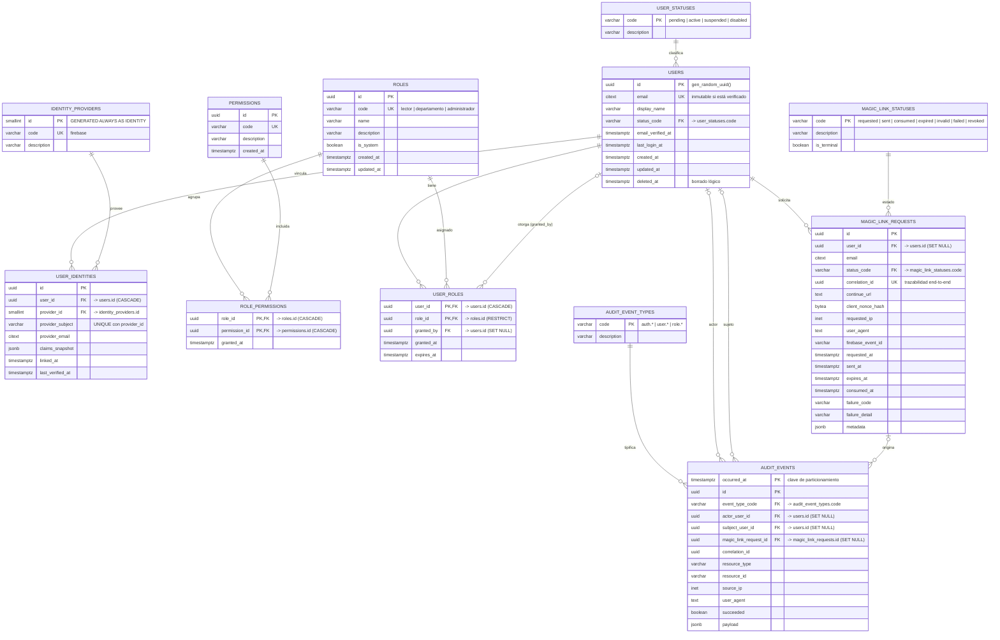
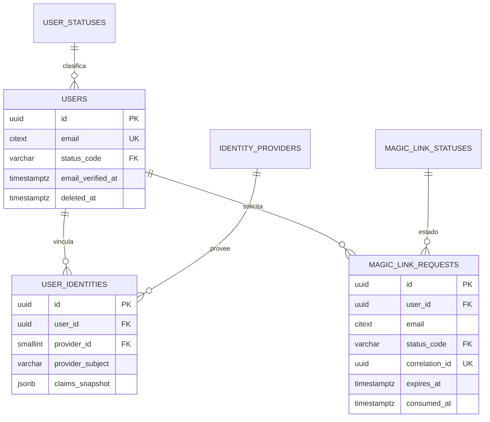
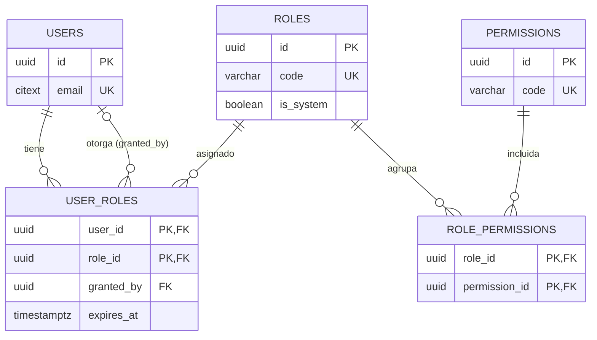
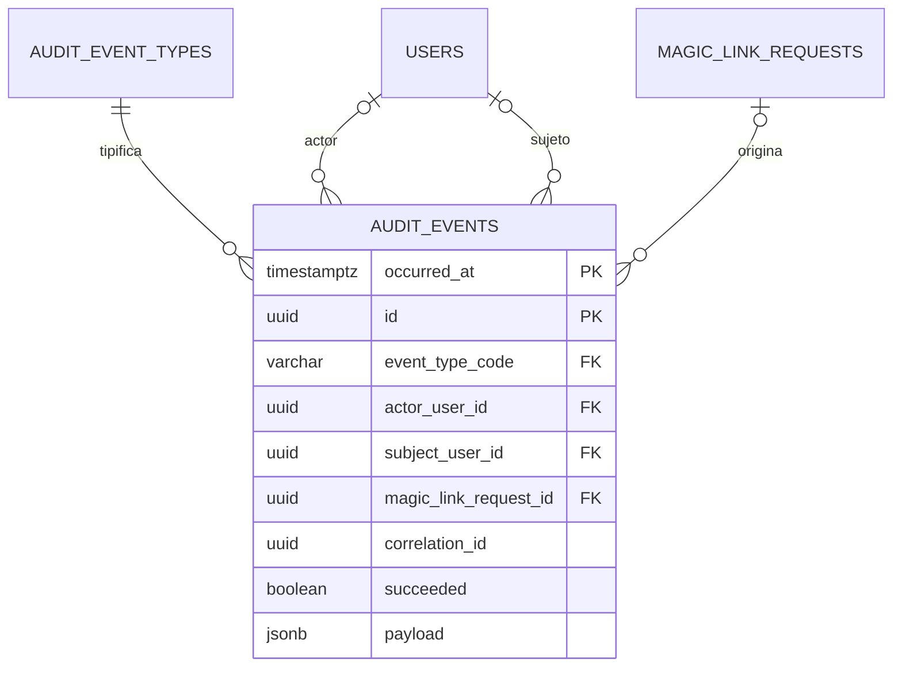

# MER — Módulo de Autenticación, Autorización y Auditoría

Diagrama entidad-relación del módulo (UTT Connect) generado a partir del script SQL de autenticación.
Motor: **PostgreSQL 18** (compatible con 15+).

> **Vista renderizada:** abre `docs/mer-autenticacion.html` en el navegador para ver el diagrama con zoom y descarga en SVG/PNG.

---

## 1. Diagrama general



---

## 2. Vista por bloques

### 2.1 Identidad del usuario



### 2.2 Autorización (RBAC)



### 2.3 Auditoría



---

## 3. Cardinalidades en palabras

| Relación | Cardinalidad | Lectura |
|---|---|---|
| `user_statuses` → `users` | 1 : N | Un estado agrupa muchos usuarios; cada usuario tiene exactamente un estado. |
| `users` → `user_identities` | 1 : N | Un usuario puede tener varias identidades (hoy solo Firebase). |
| `identity_providers` → `user_identities` | 1 : N | Un proveedor emite muchas identidades. |
| `users` → `magic_link_requests` | 1 : N | Un usuario puede pedir muchos enlaces; la solicitud puede no tener usuario aún (`user_id` nulo). |
| `magic_link_statuses` → `magic_link_requests` | 1 : N | Cada solicitud tiene un estado del catálogo. |
| `users` ↔ `roles` | N : M | Resuelta por `user_roles`, con `expires_at` y `granted_by`. |
| `roles` ↔ `permissions` | N : M | Resuelta por `role_permissions`. |
| `users` → `user_roles` (`granted_by`) | 1 : N | Auto-referencia: quién otorgó el rol. |
| `audit_event_types` → `audit_events` | 1 : N | Catálogo de tipos de evento. |
| `users` → `audit_events` | 1 : N (×2) | Un usuario puede ser actor y/o sujeto de muchos eventos. |
| `magic_link_requests` → `audit_events` | 1 : N | Cada evento puede rastrearse hasta la solicitud que lo originó. |

---

## 4. Reglas de negocio dentro del modelo

| Regla | Dónde vive | Efecto |
|---|---|---|
| Solo correos `@utt.edu.mx` | `users_email_domain` | `CHECK` con expresión regular. |
| Correo verificado ⇒ estado ≠ `pending` | `users_verified_email_consistency` | `CHECK` cruzado. |
| Estado `active` exige correo verificado | `users_active_requires_verified_email` | `CHECK` cruzado. |
| Correo inmutable tras verificación (RF‑09 / R12) | `trg_users_prevent_email_change` | Trigger `BEFORE UPDATE` que lanza excepción. |
| `updated_at` automático | `trg_users_set_updated_at`, `trg_roles_set_updated_at` | Trigger `BEFORE UPDATE`. |
| Una identidad por proveedor y usuario | `uq_user_identity_provider` | `UNIQUE (user_id, provider_id)`. |
| Una identidad por sujeto de proveedor | `uq_user_identity_subject` | `UNIQUE (provider_id, provider_subject)`. |
| Consumo coherente del enlace | `magic_link_consumed_status` | `consumed` ⇔ `consumed_at` no nulo. |
| Expiración posterior a la solicitud | `magic_link_expiration` | `CHECK (expires_at > requested_at)`. |
| Vigencia del rol | `user_role_expiration` | `CHECK (expires_at IS NULL OR expires_at > granted_at)`. |
| Catálogos con formato controlado | `role_code_format`, `permission_code_format` | `CHECK` con regex. |
| Payloads JSON siempre objeto | `user_identity_claims_object`, `magic_link_metadata_object`, `audit_payload_object` | `CHECK jsonb_typeof(...) = 'object'`. |

---

## 5. Lo que Mermaid **no** puede mostrar

El diagrama ER describe tablas, columnas y llaves. Estos elementos del script existen en la base de datos pero no se representan visualmente:

| Elemento | Detalle |
|---|---|
| **Particionamiento** | `audit_events` está particionada por rango de `occurred_at`; hoy solo existe la partición `audit_events_default`. |
| **Clave primaria compuesta** | En `audit_events` es `(occurred_at, id)`; se marca con doble `PK`. |
| **Índices** | 11 índices, varios parciales (`WHERE deleted_at IS NULL`, `WHERE expires_at IS NOT NULL`, `WHERE correlation_id IS NOT NULL`, etc.). |
| **Triggers** | 3 triggers: 2 de `updated_at` y 1 de inmutabilidad del correo. |
| **Extensiones** | `pgcrypto` (para `gen_random_uuid()`) y `citext` (correos sin distinción de mayúsculas). |
| **Borrado lógico** | `users.deleted_at`; no hay `DELETE` físico de usuarios en el flujo normal. |
| **Catálogos sembrados** | 4 estados de usuario, 1 proveedor, 3 roles, 7 estados de enlace y 10 tipos de evento de auditoría. |

---

## 6. Script para regenerarlo

Si modificas el esquema, actualiza el `.mmd` y renderízalo con:

```bash
npx @mermaid-js/mermaid-cli -i docs/mer-autenticacion.mmd -o docs/mer-autenticacion.svg
```

El bloque Mermaid de la sección 1 es la fuente de verdad (`docs/mer-autenticacion.mmd`).
